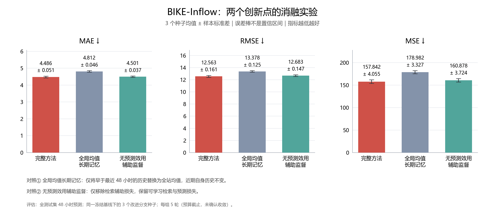
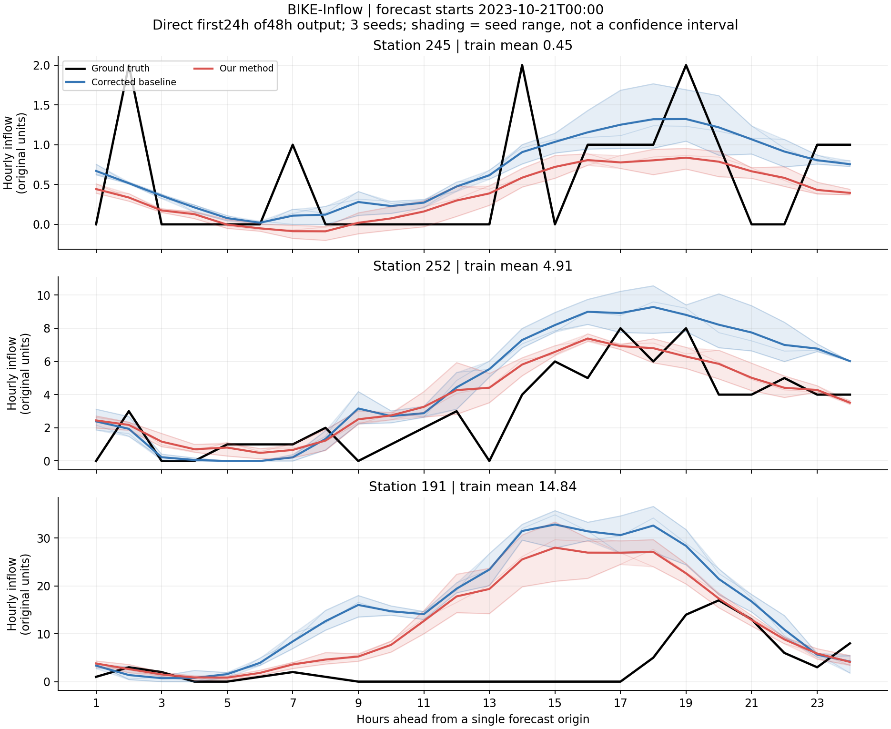

# STH-SepNet 课程项目

本项目在 [STH-SepNet](https://github.com/jiawenchen10/STHSepNet)（KDD'2025）之上完成复现与两条**独立**改进线：

- **H1 —— 节点级多周期记忆与预测效用监督的历史检索（负责人：yixuan wang）。** 五个数据集的主实验、BIKE-Inflow 三种子消融与未来 24 小时案例已完成，见[结果与图表](experiments/h1/README.md)。
- **H3 —— KAN 预测头（负责人：jinfeng guo）。** 保留独立的 BIKE-Inflow 三种子对照，见[第 7 节](#7-kan-预测头h3jinfeng-guo)。

H1 与 H3 使用**不同训练配置和输入信息量**，分别与各自的基线比较，不能视为严格同条件的直接对比；本项目**没有**声称两者已被组合成同一个模型。H2（节点—时间自适应融合）此前曾被提出，但不在本次已验证的贡献之内。

分工、比较边界与各自基线口径见[第 1 节](#1-项目概览与分工)。

---

## 1. 项目概览与分工

| 成员 | 角色 | 覆盖范围 |
|---|---|---|
| **yixuan wang** | H1 改进负责人 | 节点级多周期记忆、历史检索；五数据集主实验、BIKE 三种子消融与 24 小时案例 |
| **jinfeng guo** | H3 改进负责人 | KAN 预测头提出、实现、试点，以及 BIKE-Inflow 与基线（MLP 头）的受控对比 |
| **jinqi Liu** | 论文基线复现负责人 | 全部五个数据集的三种子基线实验、数据适配、实验登记与结果汇总 |

**比较边界（重要）。** H3 不是从 H1 完整方法中删除某个模块得到的消融；两条路线的数值**不能跨数据集、跨预算直接排名**。各成员的结果分别与其自身控制组比较，并已在报告（`report/final_report.docx`）与实验登记（`experiments/`）中分别记录训练配置、输入信息量与种子口径。

## 2. 安装环境

Python 3.10；先安装适配显卡的 CUDA 版 PyTorch，再安装依赖：

```bash
python -m pip install -r requirements-pilot.txt
```

实验环境为 PyTorch 2.10.0+cu128、Transformers 4.44.2，训练与测评使用支持 BF16 的 NVIDIA CUDA GPU。仅查看结果或重新绘图不需要 GPU。

## 3. 下载资源

### 3.1 数据集与目录

数据来自[原作者 Google Drive 下载目录](https://drive.google.com/drive/folders/1uhQqAdrIplhhKCHn0McnB-trve6_rATD?usp=drive_link)。下载后**保持时间列、节点列顺序与配套邻接不变**，按以下结构放置：

```text
dataset/
├── PEMS03/
│   ├── PEMS03.csv
│   └── PEMS03_adj.csv
├── METR/
│   ├── METR.csv
│   └── METR_adj.csv
├── BJ/
│   ├── BJ.csv
│   └── BJ_adj.csv
└── Bike/
    ├── inflow.csv
    ├── outflow.csv
    └── adj.csv
```

**邻接与信息量要求：**

- **H1 的五个数据集均需要配套邻接**（`*_adj.csv` / `Bike/adj.csv`）。BIKE 为小时级；PEMS03、METR-LA、BJ500 为五分钟级。基线均读取最近 48 步、预测未来 48 步；H1 在 BIKE 读取 240 小时，在五分钟级数据读取 2064 步。**改进使用了额外历史**，因此不能把全部收益归因于 token 编码或 BERT 预训练。
- **H3（KAN）只需 `dataset/Bike/inflow.csv`**，按原配置构建自适应超图，不额外要求邻接文件。
- 数据准备细节见 [dataset/README.md](dataset/README.md)。

### 3.2 BERT

从 [google-bert/bert-base-uncased](https://huggingface.co/google-bert/bert-base-uncased/tree/main) 下载 `config.json`、`pytorch_model.bin`、`tokenizer_config.json`、`tokenizer.json`、`vocab.txt`，放到 `huggingface/google_bert/`。H1 也可通过 `--bert-path` 指定其他目录。

### 3.3 发布内容与许可

本次发布包含 H1 代码、报告、逐窗口误差、案例数值与图，以及 H3 的 KAN 实现与受控对比；**不包含**新的原始数据、BERT 或训练权重。仓库中已有的同学文件不会删除。所有下载资源须遵守各自来源的许可（数据与模型权重遵循原作者 / Hugging Face 许可）。

## 4. 运行

### 4.1 运行入口

| 路线 | 入口 | 说明 |
|---|---|---|
| H1 | `research/run_h1.py` | 基线、改进、消融与评估的统一入口 |
| H3（KAN） | `src/run_main.py` | 官方入口，`--use_kan` 追加 KAN 开关 |

若仓库中另有统一入口（如 `run_coursework.py` / `run_coursework.ps1`）已接入等价的 `--use_kan` / `--stage kan` 分支，可按该统一入口运行；替换点、唯一受控变量与结论不变，以当前仓库代码为准，并在本 README 中记录实际使用的入口。

### 4.2 H1：冻结基线 → 改进与消融 → 评估

**（1）训练每城一份冻结基线：**

```bash
python research/run_h1.py --dataset pems03 --stage baseline --seed 2021 --output runs/h1/pems03/baseline
```

**（2）多周期记忆与历史检索（负责人：yixuan wang）：**

```bash
python research/run_h1.py --dataset pems03 --stage improved --seed 2021 --baseline runs/h1/pems03/baseline --output runs/h1/pems03/seed_2021
```

- 数据集参数：`pems03`、`metr_la`、`bj500`、`bike_inflow`、`bike_outflow`。
- 将改进分支的种子与输出目录分别改为 2022、2023，**复用同一基线目录**；另加 `--numeric-calibration runs/h1/pems03/seed_2021/numeric_calibration.pt` 共用 seed-2021 的数值周期校准，不重新训练基线或数值通路。
- 新基线默认最多 20 轮；H1 最多 5 轮；验证集 raw MSE 连续 5 轮无改善则早停并保留最佳权重。达到 5 轮不等于收敛。已发布的历史基线保留各自原始训练历程，不冒充本次从零训练的结果。
- `--resume` 可从同一输出目录的完整状态续训；`--data-root`、`--bert-path` 可重定位资源；训练前可加 `--check-data` 仅检查数据。
- H1 代码使用 `models/sthsepnet_h1.py` 与 `layers/h1/`，不覆盖 KAN 的模型与算子；新入口不依赖旧队列、旧 pilot 或历史门禁文件。

**（3）BIKE-Inflow 消融**（分别加 `--arm global_long` 或 `--arm no_utility`，为每臂/种子使用独立输出目录，仍共享同一基线；`global_long` 的数值周期校准会独立拟合，不借用完整方法的个体历史校准）：

```bash
python research/run_h1.py --dataset bike_inflow --stage improved --arm global_long --seed 2021 \
  --baseline runs/h1/bike_inflow/baseline --output runs/h1/bike_inflow/global_long_2021
```

**（4）评估已有权重**（若有**自己训练**的最终权重可独立重测，评估不会覆盖原报告）：

```bash
python research/run_h1.py --dataset pems03 --stage evaluate \
  --checkpoint-dir runs/h1/pems03/seed_2021 --baseline runs/h1/pems03/baseline \
  --output runs/h1/pems03/evaluation_2021
```

评估需要完整的基线最佳权重、改进最佳权重、数值校准、原始 BERT 与报告配置。默认按固定种子重测；原 GCN 在 eval 阶段仍有随机 top-k 扰动，因此不保证与历史测试逐位相同。完整 RNG 重放与逐点流量导出选项见 `python research/run_h1.py --help`。

### 4.3 H3（KAN，BIKE-Inflow）（负责人：jinfeng guo）

KAN 试点与原版 MLP 基线使用**完全相同的训练脚本、数据划分、LLM 骨干（BERT）、`fusion_gate=adaptive`、超参数与训练预算**。唯一受控变量是预测头类型：`--use_kan`。门控融合模块内部的线性层不改动；KAN 头的 `in_features/out_features` 与原 MLP 完全一致（192 → 48），且**不引入额外历史输入**，因此 H3 与基线是**等信息化对比**。

- 替换点：仅替换门控融合之后、用于输出最终预测的 MLP 头 `FlattenHead.linear: nn.Linear(192, 48)` → `KANLinear(192, 48; grid_size=5, spline_order=3)`。
- 网格自适应：刻意**关闭 `update_grid`**，保证对比干净。
- 种子：**2021 / 42 / 7**（与主线 H1 的 2021 / 2022 / 2023 是不同集合，跨实验比较时不能按种子配对）。
- 数据：`dataset/Bike/inflow.csv`；BERT 权重放 `huggingface/google_bert/`。
- 环境修复共用：seed 生效、Windows spawn 保护、checkpoint key 前缀修复、dtype 适配、本地路径修复等由基线与 KAN 共用同一份代码，不属于科学变量。

**（1）BIKE-Inflow MLP 基线命令（无 `--use_kan`）：**

```bash
python -u src/run_main.py --task_name long_term_forecast --is_training 1 \
  --root_path ./dataset/Bike/ --data_path inflow.csv --model_id BIKE_48_48 \
  --model pool --data inflow --features M --seq_len 48 --label_len 48 --pred_len 48 \
  --factor 3 --des Exp --itr 1 --d_model 768 --d_ff 32 --batch_size 16 \
  --learning_rate 0.0001 --llm_model BERT --llm_dim 768 --llm_layers 6 \
  --train_epochs 50 --model_comment abl --gamma 1.0 --fusion_gate adaptive \
  --enc_in 295 --dec_in 295 --c_out 295 --node_num 295 --scale_hyperedges 3 \
  --seed 2021 --num_workers 0
```

**（2）KAN 预测头命令（仅追加 KAN 开关）：**

```bash
python -u src/run_main.py --task_name long_term_forecast --is_training 1 \
  --root_path ./dataset/Bike/ --data_path inflow.csv --model_id BIKE_48_48 \
  --model pool --data inflow --features M --seq_len 48 --label_len 48 --pred_len 48 \
  --factor 3 --des Exp --itr 1 --d_model 768 --d_ff 32 --batch_size 16 \
  --learning_rate 0.0001 --llm_model BERT --llm_dim 768 --llm_layers 6 \
  --train_epochs 50 --model_comment abl --gamma 1.0 --fusion_gate adaptive \
  --enc_in 295 --dec_in 295 --c_out 295 --node_num 295 --scale_hyperedges 3 \
  --seed 2021 --use_kan --kan_grid_size 5 --kan_spline_order 3 --num_workers 0
```

另两个种子将 `--seed` 分别改为 42、7，其余参数完全一致。每个种子单独保存日志、预测/真值数组与 `report.json`，**不要覆盖已有 run**。

**（3）冒烟与验证**（在跑正式 3 seeds 前至少完成）：

1. sanity：随机 batch `(2, 48, 295)` 下 MLP/KAN 双版本 forward + backward 通过；参数量符合预期（MLP 头 9,264；KAN 头 103,680；总参数差 94,416）。
2. 1-epoch 全流程冒烟：训练 → checkpoint 保存/加载 → 清理，exit 0。
3. 指标复算：用 `eval_metrics.py` / `collect_results.py` 从保存的 `.npy` 重新计算 MAE/RMSE/robust MAPE，不直接信任训练日志中的打印值（脚本与已保存数组见 `sths-repro`，见[第 7.3 节](#73-复现)）。

### 4.4 范围与种子口径

H1 主实验与消融的三个种子是**同一冻结骨干下的 adapter 种子**；24 小时案例另有三对独立训练的基线/完整方法。H3 使用 2021/42/7，保持自己的训练与测评协议。两条路线各自与其控制组比较，不做跨路线排名。

## 5. 论文基线复现结果（负责人：jinqi Liu）

基于本地修正版 STH-SepNet（BERT），输入 48 步、预测 48 步。下表为种子 2021、2022、2023 的均值 ± 样本标准差，**仅包含基线，不包含 H1/H3 改进**：

| 数据集 | MAE ↓ | RMSE ↓ |
|---|---:|---:|
| BIKE-Inflow | 5.51 ± 0.05 | 15.27 ± 0.30 |
| BIKE-Outflow | 5.47 ± 0.02 | 13.83 ± 0.05 |
| PEMS03 | 21.34 ± 0.21 | 35.56 ± 0.47 |
| BJ500 | 5.97 ± 0.10 | 10.28 ± 0.33 |
| METR-LA | 10.14 ± 0.53 | 17.28 ± 0.68 |

结果见[汇总 JSON](results_coursework/run_jinqi_baseline/summary.json)与[逐种子 CSV](results_coursework/run_jinqi_baseline/per_seed.csv)（该目录由基线复现负责人单独管理）。上述为本地复现值，**并非论文官方数值**；与 H1/H3 比较时应核对各自的训练配置、输入信息与种子口径。

## 6. H1 实验结果（负责人：yixuan wang）

完整基线对照、15 份报告、三指标均值/样本标准差见[主实验表](experiments/h1/main/table.md)、[逐种子 CSV](experiments/h1/main/per_seed.csv) 与[单份基线 CSV](experiments/h1/main/baselines.csv)。以下均为本地修正版结果，不是原论文官方指标：

| 数据集 | H1 MAE ↓ | H1 RMSE ↓ | H1 MSE ↓ |
|---|---:|---:|---:|
| PEMS03 | 18.2208 ± 0.1031 | 32.0173 ± 0.1739 | 1025.1255 ± 11.1542 |
| METR-LA | 8.9335 ± 0.1238 | 17.9998 ± 0.1236 | 324.0029 ± 4.4506 |
| BJ500 | 5.2374 ± 0.0205 | 9.6827 ± 0.0435 | 93.7553 ± 0.8437 |
| BIKE-Inflow | 4.4859 ± 0.0509 | 12.5628 ± 0.1608 | 157.8417 ± 4.0548 |
| BIKE-Outflow | 4.4453 ± 0.0579 | 11.5271 ± 0.1172 | 132.8834 ± 2.6966 |

**局限：** H1 的平均 MAE 在五个数据集上均改善，但 METR-LA 的 RMSE/MSE 变差；所有 adapter 均为 5 轮预算截止，未确认收敛；没有证明语言预训练本身带来收益。

### 6.1 BIKE-Inflow 三种子消融



[消融表与定义](experiments/h1/ablation/table.md)。节点个体长期历史在三个种子上方向一致；效用辅助监督只有小幅平均收益、且第三个种子反向，**不能声称两项设计均显著且稳定有效**。误差棒为样本标准差，不是置信区间。

### 6.2 未来 24 小时真实流量案例

三对独立种子的原单位预测与真实流量对比：[案例 1](experiments/h1/cases/paired_24h_case_1.png)、[案例 2](experiments/h1/cases/paired_24h_case_2.png)、[案例 3](experiments/h1/cases/paired_24h_case_3.png)，以及[逐点 CSV](experiments/h1/cases/paired_24h_curves.csv)。



单次直接预测 48 小时、展示前 24 小时；训练段均值/标准差还原，无额外平滑或截断，阴影为三个种子的实际范围。日期与站点按时间位置/训练流量分位选择，**未挑选预测较好的案例**；仍存在高估与过平滑，不能用几个案例替代整体评价。

### 6.3 结果复现与重绘

不用训练即可从已发布的结果重新绘图：

```bash
python research/plot_bike_ablation.py --summary experiments/h1/ablation/summary.json
python research/plot_h1_cases.py
```

只复算已发布窗口误差中的 26 条记录（78 个 MAE/MSE/RMSE 数值），不需要数据、BERT、权重或 GPU：

```bash
python research/check_h1_results.py
```

图输出到 `outputs/h1_ablation/`、`outputs/h1_cases/`，不覆盖已发布结果。H3 的结果与复现说明见[第 7 节](#7-kan-预测头h3jinfeng-guo)。

## 7. H3 KAN 预测头（负责人：jinfeng guo）

### 7.1 动机、替换点与替换方式

原模型在门控融合之后使用固定激活的 MLP 预测头（`FlattenHead.linear = nn.Linear(192, 48)`），表达能力有限；KAN 以可学习的 B 样条基函数替代固定激活，更自适应地捕捉融合特征到预测目标之间的复杂非线性映射。

- **替换点：** 仅替换门控融合之后、用于输出最终预测的 MLP 预测头；不修改门控融合机制内部的线性层，保证消融只反映预测头这一变量。
- **替换方式：** `nn.Linear(192, 48)` → `KANLinear(192, 48; grid_size=5, spline_order=3)`，输入输出维度与原 MLP 完全一致。
- **控制：** 关闭 `update_grid` 网格自适应细化；不引入额外历史输入；不改变 BERT、超图分支、门控融合或训练预算。
- **公平性：** 基线与 KAN 共用同一修正版基线、同一环境适配修复、同一数据划分、同一 seeds 集合、同一 epoch/patience 规则；唯一科学变量是 `--use_kan`。

### 7.2 试点与结果（BIKE-Inflow，3 seeds：2021/42/7）

| 预测头 | MAE（均值±标准差） | RMSE（均值±标准差） | robust MAPE（\|y\|≥1） | 预测头参数量 | 总参数量 |
|---|---|---|---|---|---|
| MLP（基线） | 5.2570 ± 0.0302 | 14.1383 ± 0.0462 | 77.417 ± 0.827 | 9,264 | 109,219,949 |
| **KANLinear** | **5.1006 ± 0.0240** | **13.4306 ± 0.0908** | 80.175 ± 0.191 | 103,680 | 109,314,365 |
| 相对变化 | **−2.97%** | **−5.01%** | +3.6 pts | +94,416 | **+0.09%** |

- **一致性：** 3/3 个种子 KAN 均在 MAE、RMSE 上优于全部 3 个基线种子；增益幅度超过种子间标准差，可排除随机性。
- **参数效率：** KAN 头约为 MLP 头的 11 倍，但占约 1.09 亿总参数的模型仅 +0.09%，以极低的总体成本换取精度提升。
- **收敛：** MLP 基线在 36–50 轮早停（平均 42.3 轮），KAN 跑满 50 轮，单轮耗时相近（约 181 s）；KAN 未出现梯度异常。
- **诚实局限：** robust MAPE（\|y\|≥1）KAN 侧略高于基线，改善集中在 MAE/RMSE（绝对误差），相对误差在高幅样本上未同步下降，已如实记录。BIKE 反归一化后有 41.3% 样本 \|y\|<1，naive MAPE 不可报告，故采用 robust MAPE 口径。

### 7.3 复现

- **KAN 实现与开关：** 本仓库 `KAN/`（`KANLinear.py`、`KANLayer.py` 等）经 `src/run_main.py --use_kan` 使用。
- **独立复现仓库（`sths-repro`）：** 含 KAN 的 `scripts/eval_metrics.py` / `collect_results.py` 指标复算脚本、`tests/synthetic_sanity.py` 冒烟测试、`experiments/registry.csv` 运行登记、`results/data_pred/` 保存的预测/真值数组。
- **报告分析：** 见 `report/final_report.docx` 第 7 / 8.2 / 10 节。
- **数据与 BERT：** 按[第 3 节](#3-下载资源)下载后即可复现。

---

> 说明：报告正文（`report/final_report.docx`）与本 README 相互补充——README 提供运行与复现路径，报告提供三假设的机理、受控评估、局限与 agent-use 溯源。
